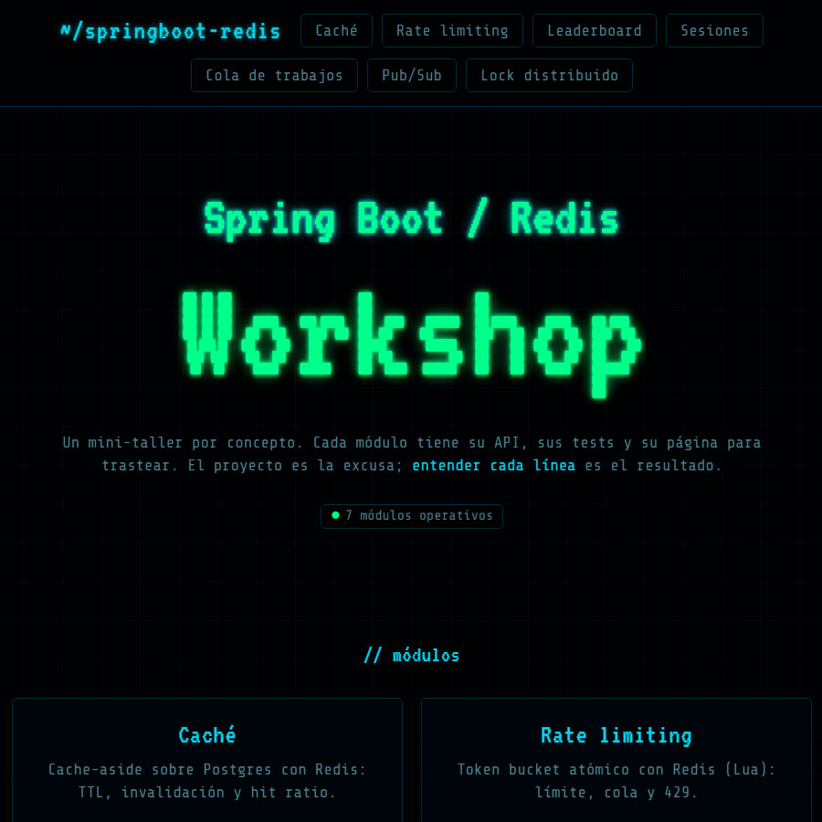
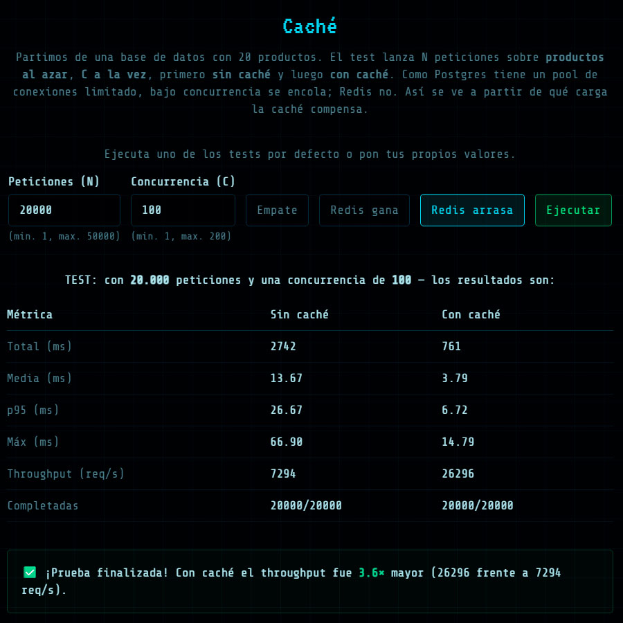
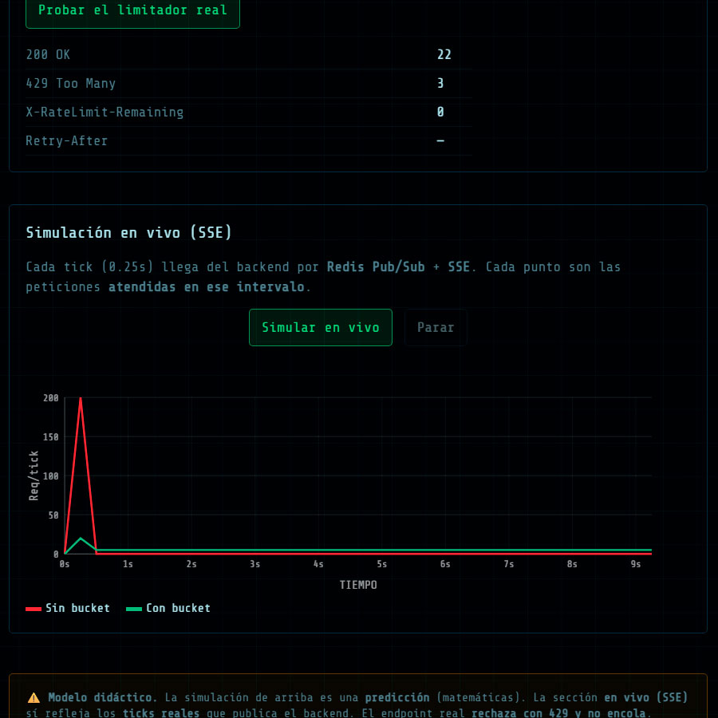
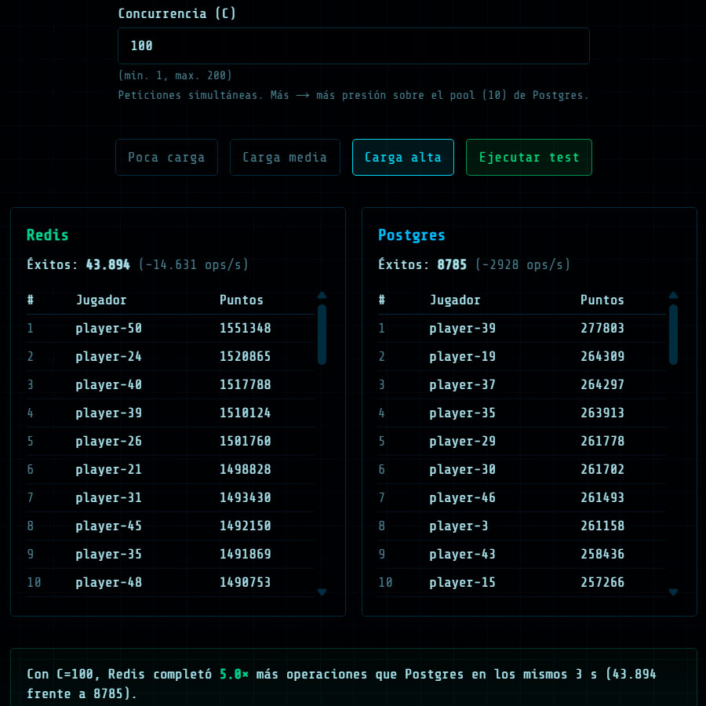
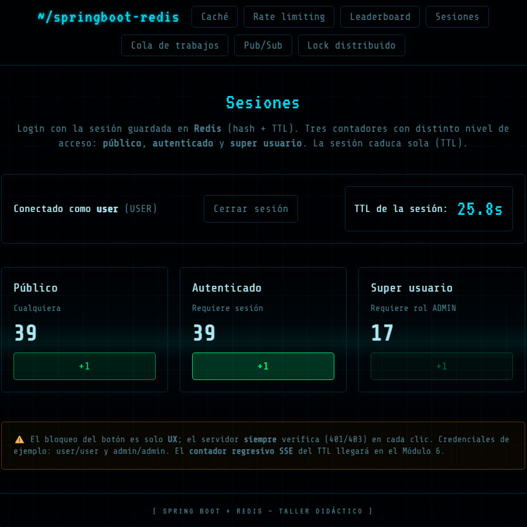
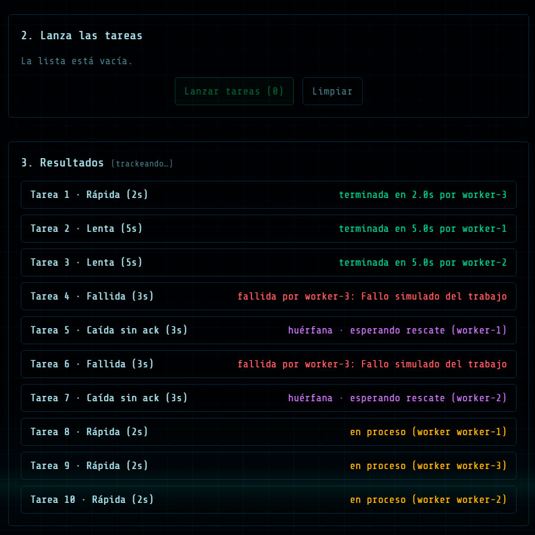
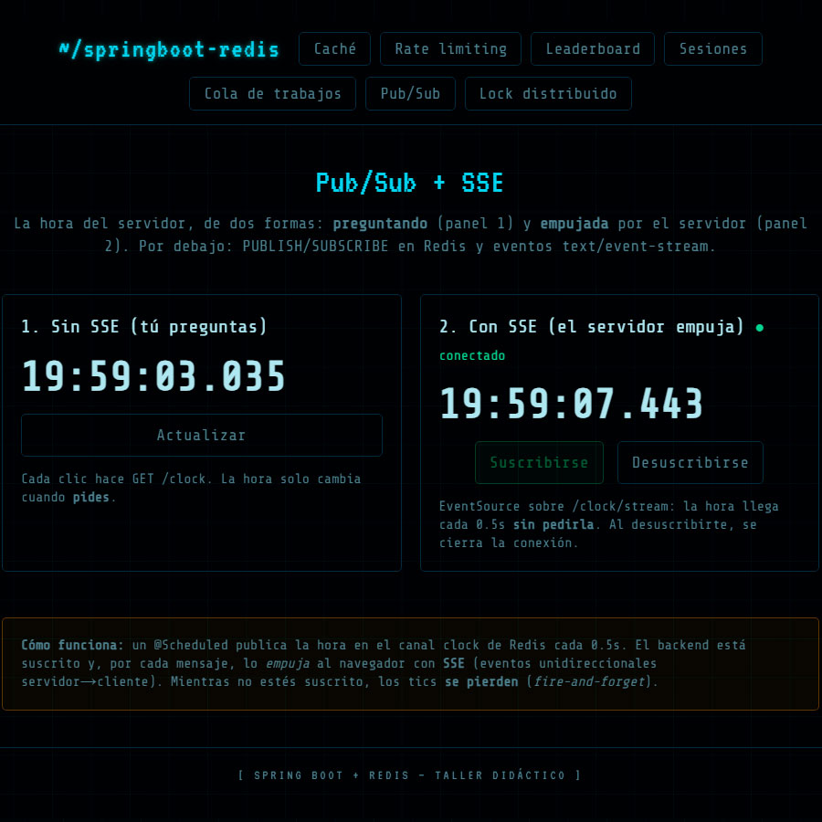
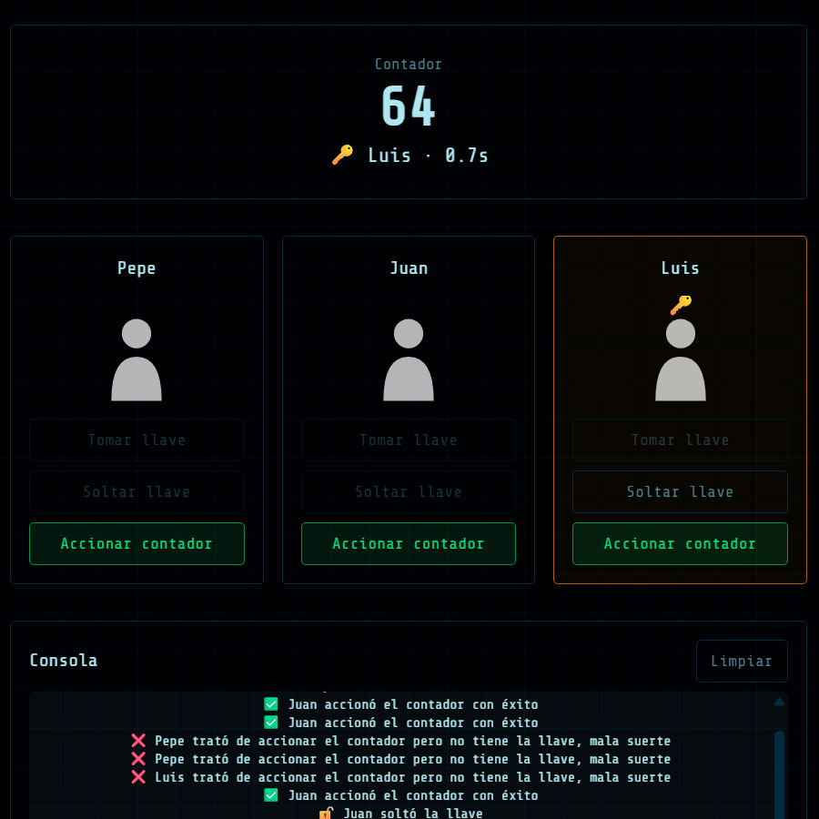

# springboot-redis-workshop

🌐 **English** · [Español](README.es.md)

<p align="center">
  
</p>

**A hands-on workshop for learning Spring Boot + Redis.** A collection of independent mini-modules
(cache, rate limiting, leaderboard, job queue, pub/sub, distributed lock...) to learn both
technologies by building, testing and poking at them from a frontend.

> **Goal:** learn Spring Boot and Redis. The project is the excuse; understanding every line is the
> result.

## Modules

Each module demonstrates a Redis pattern and ships its own API, its tests and its frontend page.

### 1 — Cache

<p align="center"></p>

We show the speed difference when reading random products from a list, **with and without cache**.
We fire a number of requests at different concurrency levels, set up several scenarios and compare
the results.

### 2 — Rate limiting

<p align="center"></p>

A **token bucket** limits how many requests an endpoint accepts per IP. We see how the bucket
refills over time, when it answers `429`, and how it spreads the load instead of letting it all
through at once.

### 3 — Leaderboard

<p align="center"></p>

We compare how fast a ranking updates with a Redis **sorted set** versus doing it with Postgres
`UPDATE`s, under heavy concurrency. We measure operations per second.

### 4 — Sessions

<p align="center"></p>

Login with the session stored in **Redis** (hash + TTL) and the token in an `HttpOnly` cookie. We
see how it expires on its own, role-based access, and the TTL countdown live.

### 5 — Job queue

<p align="center"></p>

We enqueue tasks and process them **in the background** with several workers, without blocking the
request. We see the distribution, the `ack`, the retries, and the rescue of stuck tasks.

### 6 — Pub/Sub

<p align="center"></p>

A **live clock**: the server publishes events to a Redis channel and pushes them to the browser with
**SSE**. We compare asking (polling) versus the server pushing, and use it to watch rate limiting
and session TTL in real time.

### 7 — Distributed lock

<p align="center"></p>

A resource only one can touch at a time. With a lock in Redis (`SET NX PX`) we manage who holds
"the key", how they release it (only the owner), and how it frees itself if the owner dies.

## Stack

- **Backend**: Java 21 + Spring Boot 4.x
- **Frontend**: Next.js (App Router, TypeScript, Tailwind)
- **Data**: PostgreSQL + Redis (Docker Compose)

## Structure

```
apps/
  backend/    Spring Boot — a single project with modules by concept
  web/        Next.js — one page per module
compose.yaml  Postgres + Redis
```

> `docs/PLAN.md` is a local working note (not versioned).

## Dev

Requirements: JDK 21, Node.js 24+, Docker.

```bash
# Infrastructure (Postgres + Redis)
docker compose up -d

# API (from apps/backend) → http://localhost:8000
./mvnw spring-boot:run

# Web (from apps/web) → http://localhost:3000
npm install
npm run dev
```

Check: `curl http://localhost:8000/healthz`
